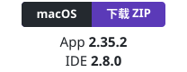
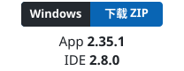
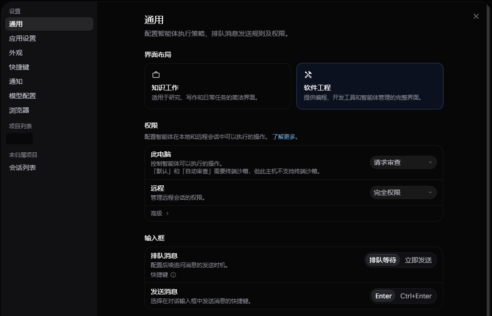
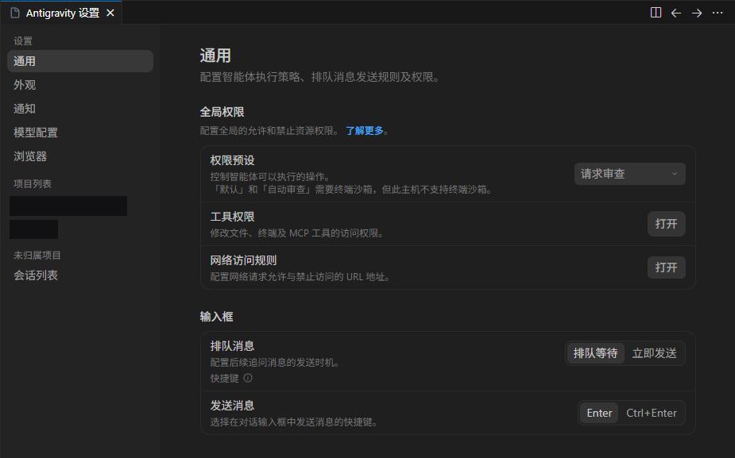
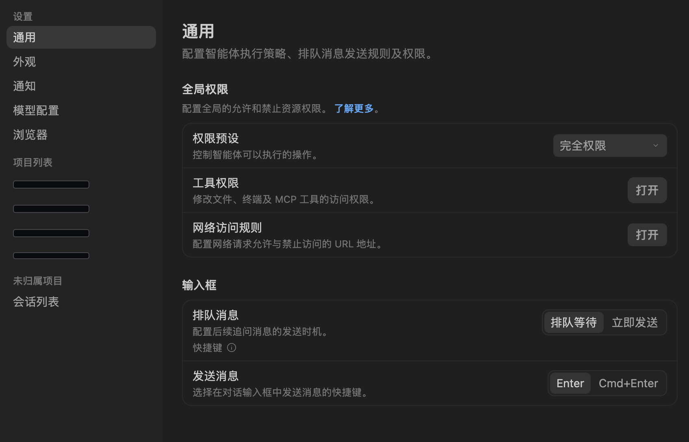
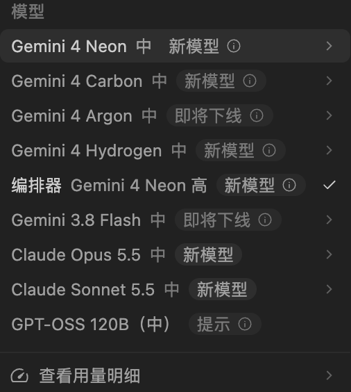

# antigravity-zh-cn

在 macOS 或 Windows 上一键打开 Google Antigravity 桌面版和 Antigravity IDE 的简体中文界面，也可以一键切回英文。脚本从 Google 官方应用生成单独的中文副本，切回英文时打开官方原版。

<p align="center">
  <a href="https://github.com/AI-Good-Tool/antigravity-zh-cn/releases/download/macos-v1.0.0/Antigravity-macOS-zh-CN.zip"><picture>
    <source media="(min-width: 600px)" srcset="docs/downloads/macos.svg" width="208" height="80">
    
  </picture></a>
  <a href="https://github.com/AI-Good-Tool/antigravity-zh-cn/releases/download/windows-v1.0.0/Antigravity-Windows-zh-CN.zip"><picture>
    <source media="(min-width: 600px)" srcset="docs/downloads/windows.svg" width="208" height="80">
    
  </picture></a>
</p>

[macOS 使用方法](#macos-使用方法) · [Windows 使用方法](#windows-使用方法) · [设置截图](#界面截图)

## 适配版本

下表列出截至 **2026 年 11 月 25 日**验证的版本。[Google Antigravity 下载页](https://antigravity.google/download)

| 平台 | Antigravity App（桌面版） | Antigravity IDE（独立版） |
| --- | --- | --- |
| Windows 11 x64 | **2.35.1** | **2.8.0** |
| macOS 26.7（Apple Silicon） | **2.35.1**，兼容 **2.34.0** | **2.8.0** |

桌面版覆盖常用菜单、设置、操作按钮、模型标签、推理强度和模型提示。IDE 覆盖 Antigravity 设置、智能体面板、模型菜单和部分内置技能说明。IDE 的编辑器菜单和通用设置由 Microsoft 简体中文语言包翻译。

## Windows 使用方法

1. 从 Google 官网安装要使用的 **Windows x64** 应用，打开「关于」确认版本和上表一致。[Google 官方下载](https://antigravity.google/download)
2. **使用 IDE 时**，先在官方 IDE 按 `Ctrl+Shift+X` 打开扩展面板，安装 **Chinese (Simplified) Language Pack**。IDE 2.8.0 已验证语言包 **1.106.0**。需要选择版本时，在扩展详情页的菜单里点「安装其他版本」。[Microsoft 简体中文语言包](https://marketplace.visualstudio.com/items?itemName=MS-CEINTL.vscode-language-pack-zh-hans)
3. 打开 Release，在 **Assets** 下载 **`Antigravity-Windows-zh-CN.zip`**。在资源管理器里右键 ZIP，选择「全部解压缩」。打开解压得到的 `Antigravity-Windows-zh-CN` 文件夹，再进入 `windows`。请保留整个解压目录，脚本需要读取上一级目录里的词库。[Windows Release](https://github.com/AI-Good-Tool/antigravity-zh-cn/releases/tag/windows-v1.0.0)
4. 保存工作并完全退出要切换的应用。桌面版若还在任务栏右下角的系统托盘里，从托盘图标菜单选择「退出」。
5. 双击下表中的脚本，等待应用打开。首次切换中文需要复制应用，稍后再次执行同一脚本会复用已生成的副本。

   | 要切换的应用 | 打开简体中文 | 恢复英文 |
   | --- | --- | --- |
   | Antigravity 桌面版 | `App 一键切换中文.cmd` | `App 一键恢复英文.cmd` |
   | Antigravity IDE | `IDE 一键切换中文.cmd` | `IDE 一键恢复英文.cmd` |

恢复英文脚本会用英文启动官方安装版。中文副本位于 `%LOCALAPPDATA%\AntigravityLocalLanguage`。两种界面共用本地资料，同一个应用每次打开一种语言。

### Windows 更新

1. 桌面版显示「用官方版更新」时，保存工作后点击按钮并确认「打开官方版」。IDE 双击 `IDE 一键恢复英文.cmd` 打开官方版。
2. 在官方版里完成更新。如果更新功能不可用，从 Google 官网下载新版安装程序。[Google 官方下载](https://antigravity.google/download)
3. 退出更新后的应用，下载适配新版的切换脚本，再双击对应的中文脚本。如果脚本提示版本不匹配，可以先双击英文脚本继续使用官方版。

自定义安装目录的用法见 [Windows 详细说明](windows/README.md)。

## 界面截图

### Windows

Antigravity App 2.35.1 的中文通用设置，左侧项目名称已打码。



Antigravity IDE 2.8.0 的中文通用设置，左侧项目名称已打码。



### macOS

#### Antigravity App 2.35.1

模型选择器显示中文推理强度、模型状态和用量入口。


#### Antigravity IDE 2.8.0

「设置 → 通用」页面。左侧项目名称已打码。



智能体面板里的模型选择器显示中文状态和推理强度。将鼠标移到模型旁的 ⓘ，可以查看该模型的中文提示。



## macOS 使用方法

### 使用前准备

1. 从 Google 官网安装桌面版或独立 IDE。把相应的 `Antigravity.app` 或 `Antigravity IDE.app` 放在「应用程序」目录（`/Applications` 或 `~/Applications`）。[官方下载](https://antigravity.google/download)
2. 打开 macOS Release，在 **Assets** 下载 **`Antigravity-macOS-zh-CN.zip`**。在访达双击 ZIP 解压，保留整个文件夹。四个 `.command` 脚本都在解压目录的第一层，并从同一个目录读取词库和翻译代码。[macOS Release](https://github.com/AI-Good-Tool/antigravity-zh-cn/releases/tag/macos-v1.0.0)
3. 确认终端可以执行 `/usr/bin/python3 --version`。如果 macOS 提示安装命令行开发者工具，可以运行 `xcode-select --install`，安装完成后再运行脚本。
4. **使用 IDE 时**，先在官方 IDE 按 `⇧⌘X` 打开扩展面板，搜索并安装 `MS-CEINTL.vscode-language-pack-zh-hans`。也可以下载 `.vsix`，通过命令面板的 **Extensions: Install from VSIX…** 安装。语言包会翻译编辑器自身的菜单和设置。[Microsoft 简体中文语言包](https://marketplace.visualstudio.com/items?itemName=MS-CEINTL.vscode-language-pack-zh-hans)

### 切换中文和恢复英文

1. 保存工作，在要切换的应用里按 `⌘Q` 完全退出。
2. 在访达打开解压后的文件夹，按下表双击对应脚本。

   | 应用 | 切换到简体中文 | 恢复英文 |
   | --- | --- | --- |
   | 桌面版 | `一键切换中文.command` | `一键恢复英文.command` |
   | 独立 IDE | `IDE 一键切换中文.command` | `IDE 一键恢复英文.command` |

3. 等终端显示启动结果。第一次切换中文需要复制应用和签名，后续启动会复用已生成的同版本副本。

如果访达没有执行脚本，可以在终端进入解压目录，再运行下方对应的命令。

```sh
/bin/zsh "./一键切换中文.command"
/bin/zsh "./一键恢复英文.command"
/bin/zsh "./IDE 一键切换中文.command"
/bin/zsh "./IDE 一键恢复英文.command"
```

中文版和英文版使用同一套本地应用资料，请一次打开同一应用的一个版本。中文副本保存在 `~/Library/Application Support/Antigravity 语言切换/` 或 `~/Library/Application Support/Antigravity IDE 语言切换/`。

### 更新应用

#### 桌面版

1. 如果仍看到旧按钮「重启以更新」，先保存并退出，再双击本仓库的 `一键切换中文.command` 生成新版脚本对应的中文副本。
2. 新副本检查到更新时会显示 **用官方版更新**。保存工作后，点击按钮并确认 **打开官方版**。脚本会核验原版签名，正常退出中文副本，并打开 Google 官方原版。
3. 在官方原版完成更新。如果原版没有自动开始检查，在 macOS 菜单栏选择 **Antigravity → Check for Updates…**，然后按原版提示重启。
4. 等更新完成并退出原版，再双击 `一键切换中文.command`。脚本会根据新版本生成中文副本。

中文副本由本机签名。Google 更新包由 Google 签名，macOS 会在官方原版中核验和安装更新。

#### 独立 IDE

1. 保存后退出 IDE，双击 `IDE 一键恢复英文.command` 打开官方原版。
2. 通过官方原版完成更新，或从官网下载新版本放入「应用程序」。[官方下载](https://antigravity.google/download)
3. 更新完成后退出原版，双击 `IDE 一键切换中文.command`。

### 常见问题

- **提示找不到应用**。检查「应用程序」中的文件名和所在目录，确认选了桌面版或独立 IDE 对应的脚本。
- **提示原版签名有问题**。从 Google 官网重新安装对应版本，再执行切换脚本。[官方下载](https://antigravity.google/download)
- **IDE 智能体面板是中文，编辑器菜单仍是英文**。在官方 IDE 安装 Microsoft 简体中文语言包，退出后重新运行对应的中文脚本。
- **升级后提示界面加载方式变化**。用恢复脚本打开英文原版，待脚本适配该版本后再生成中文副本。

## 第三方许可

词库和运行时基于 Antigravity Chinese Localization 社区项目，保留上游的 MIT 许可及版权声明。[上游项目](https://github.com/antigravity-cn-community/Antigravity-Chinese-Localization) · [第三方许可](LICENSE-第三方词库与运行时.txt)
